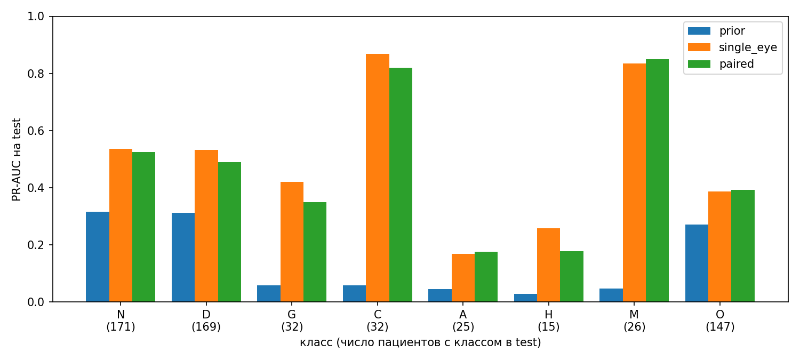

# Baseline

## Постановка

- **Разбиение** `split_v1` по пациентам, multilabel-стратификация; доли классов в частях отличаются не больше чем на 2 п.п.:

| Часть | Пациентов | N | D | G | C | A | H | M | O |
|---|---:|---:|---:|---:|---:|---:|---:|---:|---:|
| train | 2458 | 798 (32.5%) | 790 (32.1%) | 151 (6.1%) | 148 (6.0%) | 114 (4.6%) | 72 (2.9%) | 122 (5.0%) | 685 (27.9%) |
| val | 502 | 171 (34.1%) | 169 (33.7%) | 32 (6.4%) | 32 (6.4%) | 25 (5.0%) | 16 (3.2%) | 26 (5.2%) | 147 (29.3%) |
| test | 540 | 171 (31.7%) | 169 (31.3%) | 32 (5.9%) | 32 (5.9%) | 25 (4.6%) | 15 (2.8%) | 26 (4.8%) | 147 (27.2%) |

- **Признаки:** замороженный ResNet18 (ImageNet). Снимки обрезаны до глаза, фон чёрный, размер 224×224, без аугментаций.
- **Модели:**
  - `prior` — частоты классов на train (случайный уровень);
  - `single_eye` — `nn.Linear(512, 8)` на одном глазу с метками глаз, пациент — max по глазам (min для N);
  - `paired` — `nn.Linear(1024, 8)` на [левый, правый] с метками пациента.
- **Обучение:** BCE с `pos_weight`, AdamW (lr 1e-3), 100 эпох, seed 42, лучшая эпоха по val macro PR-AUC (80 у `single_eye`, 87 у `paired`).
- **Оценка:** на уровне пациента на test; пороги для F1 подобраны на val.

## Результаты

| Модель | PR-AUC macro | ROC-AUC macro | F1 macro |
|---|---:|---:|---:|
| prior | 0.143 | 0.500 | 0.231 |
| **single_eye** | **0.501** | **0.810** | 0.490 |
| paired | 0.473 | 0.798 | **0.500** |

- Хорошо: C и M (PR-AUC > 0.8).
- Плохо: A, H, O (PR-AUC 0.17-0.39). У A и H мелкие локальные признаки и мало примеров; O — смесь разных болезней.

## single_eye против paired

PR-AUC в `single_eye` лучше на 0.028. По бутстрапу на test разница на грани значимости: 95% интервал [0.001, 0.055]. На val наоборот, `paired` чуть лучше (0.505 против 0.498), так что разница неустойчива. Возможная причина в том, что у `single_eye` чистые метки глаз и вдвое больше примеров. А конкатенация признаков ничего не добавляет.

## Ограничения

- Один сид, замороженный backbone. Камера узнаётся по этим эмбеддингам (EDA 4.2), качество по камерам не считали.
- В `split_v1` 3 пары дубликатов попали в разные части (398/668, 706/89, 1043/321): val пересекается с train и test.
