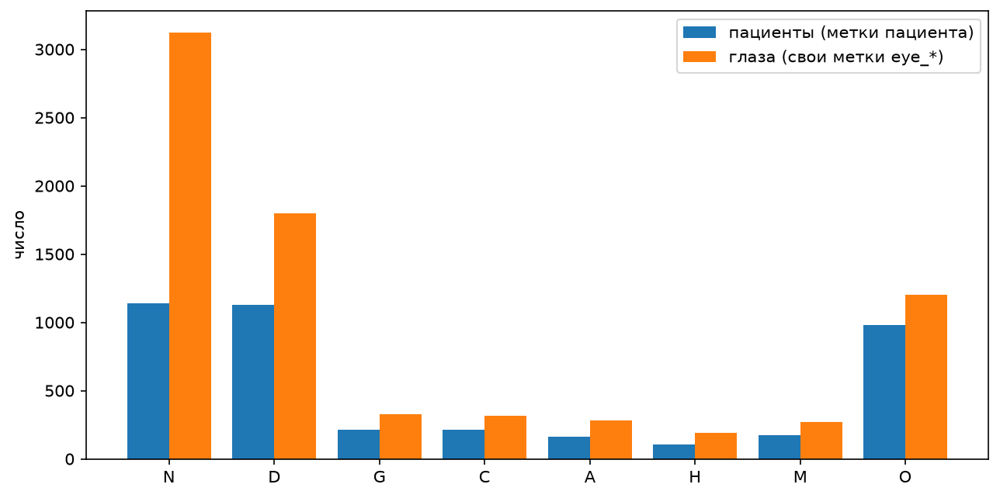
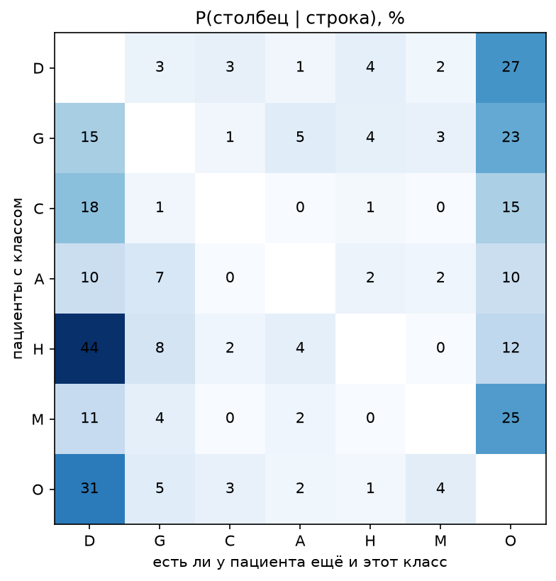
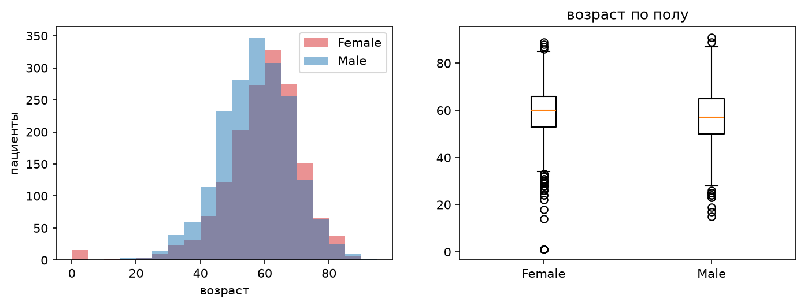
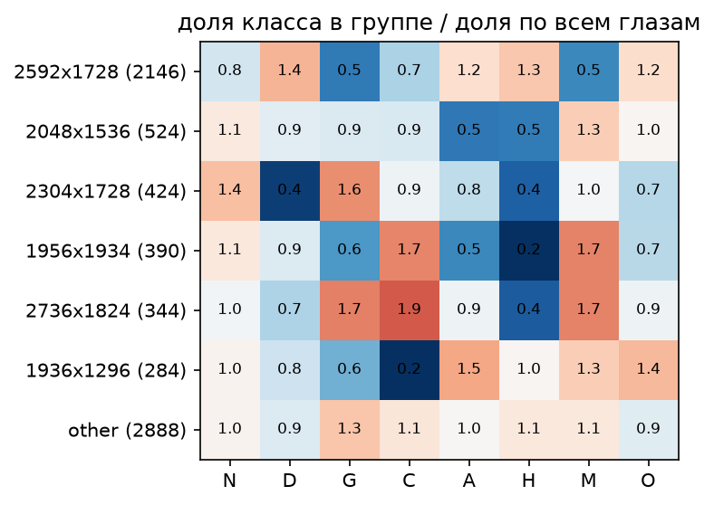
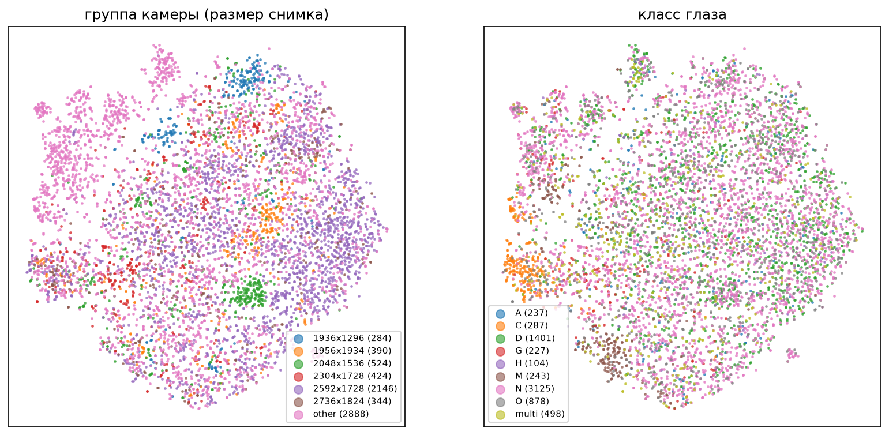
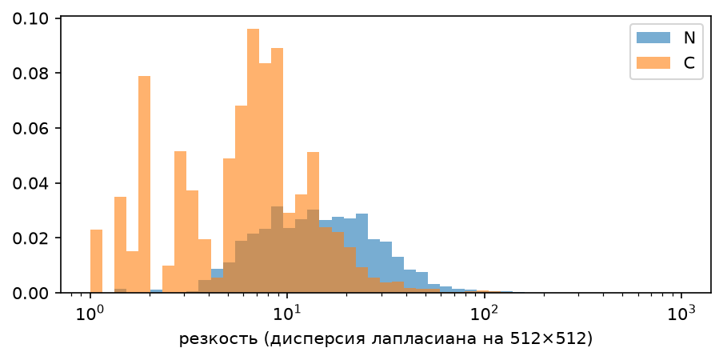

# EDA ODIR-5K: обзор данных

ODIR-5K: 3500 пациентов, 7000 снимков глазного дна (левый и правый глаз), 8 классов с несколькими метками у пациента. Расчёты, проверки и все графики: `eda/data-overview.ipynb`.

## 1. Метки

| Класс | N | D | G | C | A | H | M | O |
|---|---:|---:|---:|---:|---:|---:|---:|---:|
| Пациентов | 1140 | 1128 | 215 | 212 | 164 | 103 | 174 | 979 |
| Болезнь только на одном глазу, % пациентов с классом | - | 40.3 | 48.4 | 52.4 | 29.3 | 12.6 | 46.0 | 77.4 |

- Самый частый класс в 11 раз больше самого редкого (H). По меткам глаз N больше (44.6% глаз против 32.6% пациентов): у многих больных пациентов один глаз здоров.
- У 16.7% пациентов 2+ болезни, поэтому задача multilabel.
- O - 74 разных keyword из 102 (эпиретинальная мембрана, друзы, миелиновые волокна, лазерные следы и длинный хвост); самый неоднородный класс.
- Левый и правый глаз: формально значимый перекос только у G (66 пациентов только с левым глазом против 38 только с правым), эффект небольшой.

У 44% пациентов с H есть ещё и D: модель может «угадывать» H по признакам диабетической ретинопатии. D и O встречаются вместе у 303 пациентов; лазерные следы после лечения объясняют только 22% этих случаев.

## 2. Пациенты

- Медиана возраста 59 лет, 90% пациентов от 38 до 75 лет.
- У 16 пациентов записан возраст 1 год (все женщины, 13 с M, ID идут блоком): предположительно ошибка ввода.
- С возрастом сильнее всего растут C (2.9% у моложе 40, 18.6% у 70+) и G (12.7% у 70+). H у 70+ почти нет (1 из 488) - это стоит проверить.
- C, M чаще у женщин, H чаще у мужчин. Разницу по C возраст не объясняет: у женщин C чаще в каждой возрастной группе.

## 3. Качество снимков и ошибки в данных

- **Keywords качества.** ~30 глаз описаны только keywords качества (`low image quality`, `optic disk photographically invisible`, `no fundus image`, `anterior segment image`) и поэтому формально получают N, хотя это скорее «врач не смог оценить». 405 глаз с `lens dust` по резкости (16.9) ближе к `low image quality` (15.1), чем к остальным снимкам (23.7).
- **Не глазное дно:** `1706_left`, `1710_right` - фото переднего отдела глаза. `4580_left` помечен `no fundus image`, но это обычный снимок.
- **Дубликаты.** Точных копий файлов нет, но по корреляции мелких деталей (сосудов) подтверждены 14 пар снимков одного глаза под разными ID: 13 пар - один и тот же снимок (7 побитово одинаковых по пикселям, 6 пересохранённых), 1 пара - другой снимок того же глаза. Это 6 пар пациентов в Training Images, 2 пары между Training и Testing Images и 1 пара внутри Testing Images. У 398/668 и 706/89 разные возраст, пол или метки.
- Тёмные, маленькие (до 250×188) снимки и снимки с маленьким кругом в кадре на просмотренных примерах читаемы. Среди самых ярких снимков (выше p99) 28% с катарактой против 4.5% в среднем.

## 4. Камеры и shortcut learning

Камеру определяем по размеру снимка (101 разный размер). У 2592×1728 (31% глаз) D 37% против ~22% у остальных камер; у 2304×1728 мало D и много N; 12 из 15 снимков с белым фоном (одна камера) - катаракта.

Эмбеддинги ImageNet ResNet18 извлечены из уже обработанных снимков (обрезка до круга, чёрный фон, квадрат 224). Несмотря на это, по ним видны отдельные кластеры камер, а kNN предсказывает камеру с balanced accuracy 0.56 при случайном уровне 0.14. Значит, модель на этих признаках может опираться на камеру, а качество моделей нужно смотреть по группам камер.

## 5. Что берём в обучение

- Модель на один глаз учим на метках глаз `eye_*`, метку пациента получаем агрегацией по глазам.
- 8 сигмоид и BCE; macro PR-AUC с разбивкой по классам, `pos_weight`, сравнение по нескольким сидам.
- При разбиении по пациентам дубликаты объединяем в одну группу.
- Вход канонический: обрезка до круга с чёрным фоном, квадрат, resize; нормализация ImageNet.
- Аугментации:
  - `RandomResizedCrop(scale=(0.85, 1), ratio=(1, 1))`: сильнее обрезать нельзя, на краю круга бывают признаки болезней;
  - поворот ±15° с чёрным заполнением (по примерам, диапазон по данным не измерен);
  - яркость и контраст ×[0.75, 1.3] (межквартильный размах по данным), насыщенность ×[0.7, 1.3], hue ≤ ±0.02 (в пределах разброса тона между камерами);
  - лёгкое размытие σ ≤ 1 и шум σ ≤ 10.

Медианная резкость у C вдвое ниже, чем у N (10.5 против 23.4), поэтому сильное размытие при аугментации превращает здоровый снимок в похожий на катаракту.

## Открытые вопросы

- Что делать с ~30 нечитаемыми глазами и 405 глазами с `lens dust`: исключать из лосса, оставлять или отсеивать проверкой качества.
- Что делать с 16 пациентами с возрастом 1 год: исключить, считать пропуском или оставить.
- Отражение: без него, детерминированно отражать левые глаза в правые или случайное. CNN отличает правые снимки ODIR от отражённых левых с точностью 91% ([Kang et al., 2022](https://pmc.ncbi.nlm.nih.gov/articles/PMC8795182/)), решать экспериментом.
- Подавать ли в модель возраст и пол; сравнивать с моделью без них.
- Впечатанный текст на снимках и порог резкости для проверки качества не изучены.

## Итоги

- Метки пациента ровно следуют из keywords отдельных глаз (3500 из 3500), поэтому у каждого снимка есть своя метка `eye_*`. Копировать метки пациента на оба глаза нельзя: у 31.6% глаз больных пациентов появится болезнь, которой у этого глаза нет.
- Сильный дисбаланс: N, D и O - по 28-33% пациентов, H - 2.9%.
- 14 пар снимков одного и того же глаза записаны под разными ID пациентов, у части - с другим возрастом, полом или метками.
- Распределение классов зависит от камеры, а камера хорошо узнаётся по эмбеддингам ResNet18 даже после обрезки фона: потенциальный shortcut.
- Сильное размытие и сдвиг тона похожи на признаки катаракты или стирают их, поэтому аугментации должны быть мягкими.
