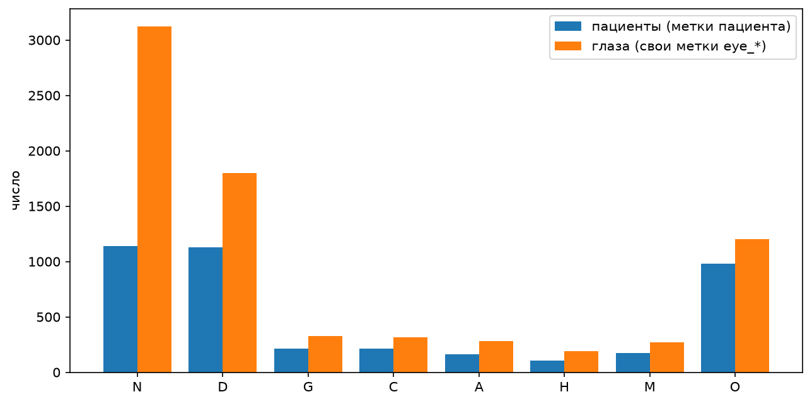
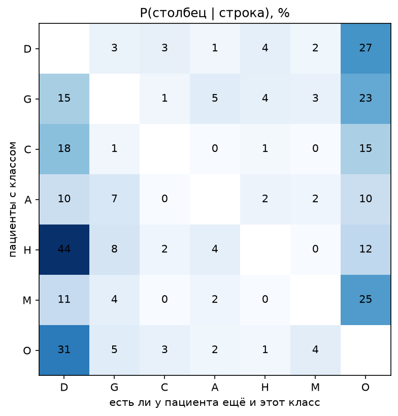
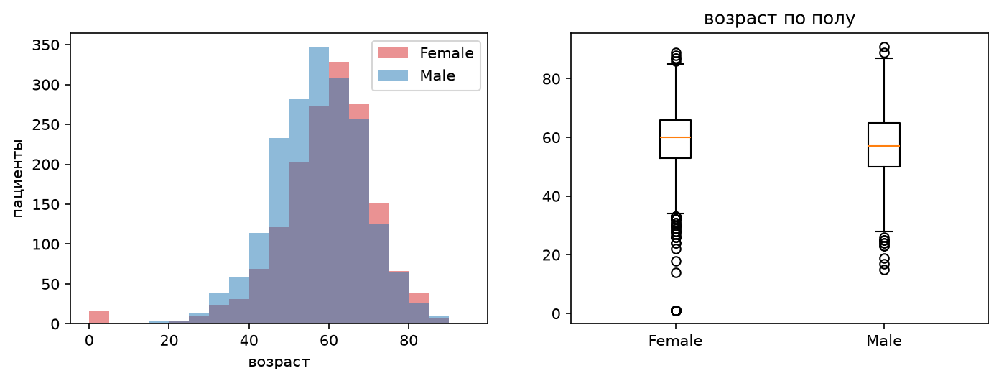
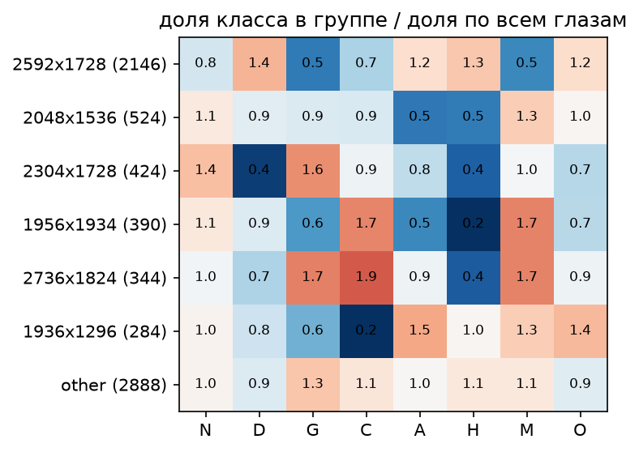
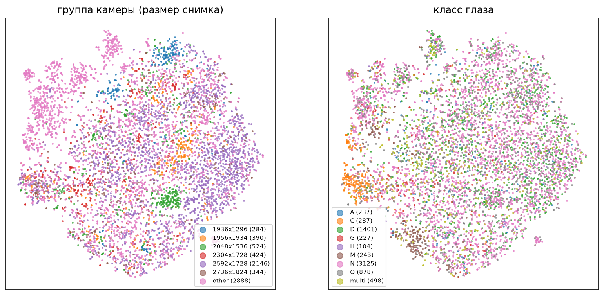
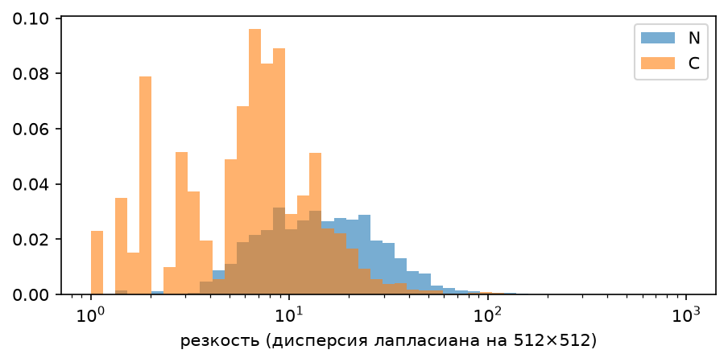
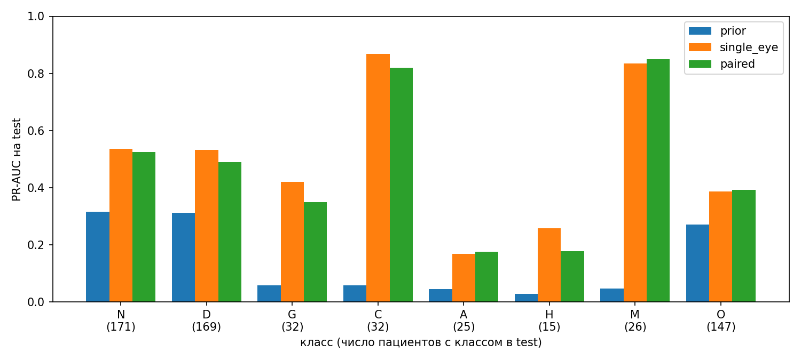

# EDA и baseline

ODIR-5K: $3500$ пациентов, $7000$ снимков глазного дна (левый и правый глаз), $8$ классов, у пациента может быть несколько меток: N - норма, D - диабет, G - глаукома, C - катаракта, A - возрастная макулярная дегенерация, H - гипертония, M - миопия, O - другое. Testing Images ($1000$ снимков) пока не используем, у них нет меток.

Файлы:
- **EDA:** `eda/eye_asymmetry.ipynb`, `eda/data-overview.ipynb`;
- **Baseline:** `scripts/extract_embeddings.py`, `scripts/train_baseline.py`, подробнее в `reports/baseline.md`;
- **Практическая значимость:** отдельный файл `reports/practical_value.pdf`.

## Содержание

| Раздел | Где смотреть |
|---|---|
| [1. Метки](#1-метки) | `eda/eye_asymmetry.ipynb` §2-5 (метки глаз, одна болезнь на одном глазу, копирование меток); `eda/data-overview.ipynb` 1.2, 1.3, 1.6 (баланс, несколько болезней, класс O) |
| [2. Пациенты](#2-пациенты) | `eda/data-overview.ipynb` 2.1-2.3 |
| [3. Качество снимков и ошибки в данных](#3-качество-снимков-и-ошибки-в-данных) | `eda/eye_asymmetry.ipynb` §3 (глаза без диагноза); `eda/data-overview.ipynb` 3.1-3.3 (`lens dust`, ошибки, дубликаты) |
| [4. Камеры и shortcut learning](#4-камеры-и-shortcut-learning) | `eda/data-overview.ipynb` 4.1, 4.2 |
| [5. Предобработка и аугментации](#5-предобработка-и-аугментации) | `src/data/images.py`; `eda/data-overview.ipynb` 5.2, 6.2-6.4 |
| [6. Baseline](#6-baseline) | `scripts/train_baseline.py`, эксперименты в [Comet](https://www.comet.com/soulqrat/retinal-image-disease-classification) |
| [Открытые вопросы](#открытые-вопросы) | - |
| [Итоги](#итоги) | - |

## 1. Метки

- **Метки глаз.** Метки пациента ровно следуют из keywords двух глаз ($3500$ из $3500$), поэтому у каждого снимка есть своя метка `eye_*` (`eye_asymmetry.ipynb`, §2).
- **Дисбаланс.** N, D и O - по $28\text{-}33\%$ пациентов, H - $2.9\%$, самый частый класс в $11$ раз больше самого редкого (`data-overview.ipynb`, 1.2).

- **Болезнь на одном глазу.** У многих пациентов болезнь только на одном глазу (`eye_asymmetry.ipynb`, §4):

| Класс | D | G | C | A | H | M | O |
|---|---:|---:|---:|---:|---:|---:|---:|
| Только на одном глазу, % пациентов с классом | $39.3$ | $47.4$ | $52.4$ | $28.8$ | $12.6$ | $45.4$ | $77.4$ |

- **Копировать метки пациента на глаза нельзя.** Это изменит хотя бы одну метку у $21.1\%$ глаз ($1467$ из $6942$); у $23.6\%$ пациентов один глаз здоров, а второй болен (`eye_asymmetry.ipynb`, §5). Модель на один глаз учим на метках глаз.
- **Несколько болезней.** У $16.7\%$ пациентов $\geq 2$ болезни, задача multilabel. У $44\%$ пациентов с H есть ещё и D (`data-overview.ipynb`, 1.3).

- **Класс O** - $74$ разных keyword из $102$, есть длинный хвост из редких keyword, самый неоднородный класс (`data-overview.ipynb`, 1.6).

## 2. Пациенты

- Медианный возраст $59$ лет. У $16$ пациентов возраст $1$ год (все женщины, $13$ с M, ID идут блоком): возможно, ошибка ввода (`data-overview.ipynb`, 2.1).
- C, M чаще у женщин, H - у мужчин (`data-overview.ipynb`, 2.2).
- С возрастом сильнее всего растут C ($18.6\%$ у $70+$) и G ($12.7\%$ у $70+$) (`data-overview.ipynb`, 2.3).

## 3. Качество снимков и ошибки в данных

- **Глаза без диагноза.** У $30$ глаз ($29$ пациентов) в keywords только замечания о качестве ($20$ из них - `low image quality`), и они формально получают N. Это скорее «врач не смог оценить», чем «здоров» (`eye_asymmetry.ipynb`, §3).
- **`lens dust`.** $405$ глаз, почти у всех есть диагноз ($69\%$ - `normal fundus`). По резкости эти снимки ближе к `low image quality`, но на примерах читаемы (`data-overview.ipynb`, 3.1).
- **Не глазное дно:** `1706_left`, `1710_right`. `4580_left` помечен `no fundus image`, но это обычный снимок (`data-overview.ipynb`, 3.2).
- **Дубликаты.** Точных копий файлов нет, но $14$ пар снимков одного глаза записаны под разными ID, часть может быть одним человеком в разное время (такой пример 1), часть - с другим возрастом, полом или метками (`data-overview.ipynb`, 3.3).

## 4. Камеры и shortcut learning

- Камеру определяем по размеру снимка. Классы распределены по камерам по-разному: у $2592 \times 1728$ D $37\%$ против $\approx 22\%$ у остальных (`data-overview.ipynb`, 4.1).
- По эмбеддингам ResNet18 kNN угадывает камеру (одну из $7$ групп) с balanced accuracy $0.56$, случайный прогноз $\approx 0.14$. И это после обрезки фона. Модель может опираться на камеру, а не на болезнь (`data-overview.ipynb`, 4.2).

## 5. Предобработка и аугментации

- Снимки обрезаем до глаза, фон чёрный, квадрат, resize (`to_canonical` в `src/data/images.py`); нормализация ImageNet (`data-overview.ipynb`, 6.2).
- `RandomResizedCrop(scale=(0.85, 1))`: сильнее обрезать нельзя, на краю круга бывают признаки болезней (`data-overview.ipynb`, 5.2).
- Поворот $\pm 15^\circ$ (выбран по примерам, по данным не измерен), яркость и контраст $\times [0.75, 1.3]$, насыщенность $\times [0.7, 1.3]$, hue $\leq \pm 0.02$ (`data-overview.ipynb`, 5.2, 6.2, 6.3).
- Только лёгкое размытие ($\sigma \leq 1$) и шум: у C резкость вдвое ниже, чем у N, и сильное размытие делает здоровый снимок похожим на катаракту (`data-overview.ipynb`, 6.4).

## 6. Baseline

- **Разбиение** `split_v1` по пациентам, multilabel-стратификация: train $2458$, val $502$, test $540$; доли классов в частях отличаются не больше чем на $2$ п.п.
- **Признаки:** замороженный ResNet18 (предобученный на ImageNet). Снимки обрезаны до глаза, фон чёрный, размер $224 \times 224$, без аугментаций.
- **Модели:** `prior` - частоты классов на train; `single_eye` - линейная голова на одном глазу с метками глаз, пациент - $\max$ по глазам ($\min$ для N); `paired` - линейная голова на [левый, правый] с метками пациента.
- **Обучение:** BCE с `pos_weight`, AdamW ($\text{lr} = 10^{-3}$), $100$ эпох, seed $42$, лучшая эпоха по val macro PR-AUC. Метрики - на уровне пациента на test. Эксперименты: [Comet](https://www.comet.com/soulqrat/retinal-image-disease-classification).

| Модель | PR-AUC macro | ROC-AUC macro | F1 macro |
|---|---:|---:|---:|
| prior | $0.143$ | $0.500$ | $0.231$ |
| **single_eye** | $\mathbf{0.501}$ | $\mathbf{0.810}$ | $0.490$ |
| paired | $0.473$ | $0.798$ | $\mathbf{0.500}$ |

- C и M распознаются хорошо (PR-AUC $> 0.8$), A, H, O - плохо ($0.17\text{-}0.39$).
- `single_eye` лучше `paired` на $0.028$ PR-AUC на test, но на val наоборот: разница неустойчива. Простая конкатенация признаков ничего не добавляет.
- В `split_v1` $3$ пары дубликатов попали в разные части (398/668, 706/89, 1043/321): val пересекается с train и test. В следующей версии разбиения такие пары держим вместе.

## Открытые вопросы

- Что делать с $30$ глазами без диагноза: исключать из лосса, оставлять или отсеивать проверкой качества. Нужно ли что-то делать с `lens dust`.
- Что делать с $16$ пациентами с возрастом $1$ год.

## Итоги

- Учим на метках глаз: копирование меток пациента портит метки у $21\%$ глаз.
- Сильный дисбаланс классов: используем macro PR-AUC, `pos_weight`.
- Камера связана с классом и узнаётся по эмбеддингам - потенциальный shortcut.
- Аугментации мягкие, сильное размытие и сдвиг тона похожи на признаки катаракты.
- Основная метрика baseline: macro PR-AUC $\mathbf{0.501}$.
